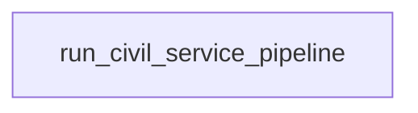

# OpenData Civil Service Ingestion

- **DAG ID:** `opendata_civil_service_ingestion`
- **Description:** No description
- **Schedule:** None
- **Catchup:** False
- **Start date:** 
- **Max active runs:** 16
- **Max active tasks:** 16
- **Tags:** dlt, ingestion, OpenData

## Details

## Task Flow

## Tasks (1)

| Task ID | Operator | Retries | Doc |
|---|---:|---:|---|
| `run_civil_service_pipeline` | _PythonDecoratedOperator | 0 |  |

---
_This file is auto-generated. Regenerate with the project's `generate_dag_docs.py` script._