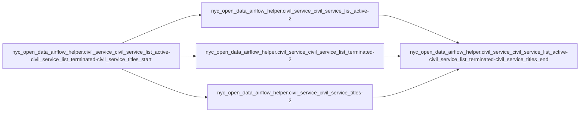

# OpenData Civil Service Ingestion (dlt Airflow Helper)

- **DAG ID:** `opendata_civil_service_ingestion_helper`
- **Description:** No description
- **Schedule:** None
- **Catchup:** False
- **Start date:** 
- **Max active runs:** 16
- **Max active tasks:** 16
- **Tags:** dlt, helper, ingestion, OpenData

## Details

## Task Flow

## Tasks (5)

| Task ID | Operator | Retries | Doc |
|---|---:|---:|---|
| `nyc_open_data_airflow_helper.civil_service_civil_service_list_active-civil_service_list_terminated-civil_service_titles_start` | EmptyOperator | 0 |  |
| `nyc_open_data_airflow_helper.civil_service_civil_service_list_active-2` | PythonOperator | 0 |  |
| `nyc_open_data_airflow_helper.civil_service_civil_service_list_terminated-2` | PythonOperator | 0 |  |
| `nyc_open_data_airflow_helper.civil_service_civil_service_titles-2` | PythonOperator | 0 |  |
| `nyc_open_data_airflow_helper.civil_service_civil_service_list_active-civil_service_list_terminated-civil_service_titles_end` | EmptyOperator | 0 |  |

---
_This file is auto-generated. Regenerate with the project's `generate_dag_docs.py` script._